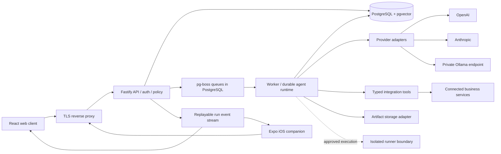

# Vuzmi architecture

Status: proposed architecture, updated with the founder's first answers. This is a design, not a statement that the capabilities below already exist.

Prepared: 4 November 2026. Initial audience: SaaS founders building, operating, marketing and selling their products. Delivery target: a polished, deployable self-hosted, single-organisation alpha within one week. Public multitenant SaaS and autonomous operation are later release gates. The source code for both deployment modes is intended to be open; the project licence has not been selected.

Confirmed constraints: the MacBook M5 and local Ollama are the testbed; later infrastructure is CPU-only with ample CPU/RAM and resource issues go to [XeoNote/Infrastructure-](https://github.com/XeoNote/Infrastructure-/); no additional spending beyond the existing GPT subscription; infrastructure requests will later be raised as issues in the infrastructure team's repository; `vuzmi.com` DNS is managed in Cloudflare. Do not provision paid services, purchase API credits or assume free-tier eligibility. Ollama is the first runtime provider; cloud providers remain disabled by default. An existing subscription may have an official eligible access/credit mechanism, but account eligibility and permitted integration are unverified. Only documented official authentication is in scope, never extracting or reusing another application's tokens.

## 1. Architectural direction

Vuzmi is one business control plane with a shared execution engine. Development, operations, support, marketing and sales are domain modules using the same agents, knowledge, integrations, approvals and audit trail. They should not become five independent agent products.

Start with a TypeScript modular monolith, deployed as an API process and a worker process. Use a React/Vite web client and an Expo/React Native iOS companion against the same versioned API. PostgreSQL stores business data, run state, events, the job queue and vectors. Keep networked dependencies few enough that a user can understand and restore a self-hosted installation.

The alpha demonstrates a complete business workflow with durable state and reviewable effects. A view with sample data must explicitly say it is a demo. Empty or disconnected modules show their real state.

### Immediate scaffold versus deployable alpha

Today's first implementation is a loopback-only local simulation: shared run/approval contracts, a deterministic simulated planner, a Fastify API, a React web interface and a local JSON storage adapter. The adapter serialises writes and atomically replaces its file within one process. It is for local development only: it is not the PostgreSQL queue/worker architecture, not suitable for multiple processes or tenants, and not a production durability guarantee. Simulated outputs and runs are labelled in the UI/API; there are no real provider calls, autonomous business effects or invented live metrics.

The deployable alpha replaces that adapter with PostgreSQL, pg-boss and a separate worker, adds real authentication, connects the available Ollama runtime and proves restart/retry behaviour. PostgreSQL and authentication are release gates from day two onward; the initial simulation alone is not a deployable alpha. The remaining sections describe this target unless marked otherwise. At present Docker's daemon is unavailable and the installed Ollama service is not listening at `localhost:11434`; implementation must report those states rather than invent successful health checks. Design and pure core/API tests can proceed without either dependency.



Arrows are logical dependencies. API and worker share domain code and a database, but can scale and restart independently. Ollama is optional and normally remains on the operator's private network. The runner is a separately restricted execution surface, never code evaluated inside the API process.

## 2. Components and repository boundaries

| Proposed location | Responsibility | Dependency rule |
| --- | --- | --- |
| `apps/web` | React/Vite interface, routing, command palette, queries and run event rendering | Uses API contracts; cannot import database or provider credentials |
| `apps/api` | Fastify HTTP routes, authentication, input validation, tenancy, admission control and SSE | Calls domain services; does not execute long agent loops |
| `apps/worker` | Queue consumers, run advancement, ingestion, retries and reconciliation | Uses domain/runtime packages; no public HTTP surface |
| `apps/mobile` | Expo iOS companion: activity, run details, approval inbox and cancel controls | Shares contracts/tokens; mobile layouts are purpose-built |
| `packages/core` | Initial runtime-validated contracts, workflow types, pure state transitions and deterministic route policy | No framework, database, network or secret dependencies; split contracts/domain packages only when useful |
| `packages/db` | SQL migrations, transaction helpers and repositories | Tenant context required for tenant-owned access |
| `packages/runtime` | Bounded agent loop, step state machine, budgets and tool policy | Provider and connector interfaces, no UI concerns |
| `packages/providers` | Native OpenAI, Anthropic and Ollama transports | Normalises capabilities and events while retaining required opaque continuation state |
| `packages/integrations` | Typed connectors, webhook verification and tool implementations | Effects require runtime authorisation and operation identity |
| `packages/ui` | Web primitives and shared design tokens | Shares tokens with mobile; does not force DOM components into React Native |
| `packages/config` | Validated environment and deployment configuration | Never serialises server secrets into clients |

These are boundaries to create as they become useful, rather than a requirement to populate empty packages immediately. Use a workspace package manager and a lockfile. Choose and pin supported Node, PostgreSQL and package versions at implementation time; record their support requirements in the development guide.

## 3. Domain modules

| Module | Owns | First useful behaviour |
| --- | --- | --- |
| Workspace and access | Organisation settings, membership, roles and policies | Bootstrap one owner; no public signup in the alpha |
| Agents | Versioned instructions, tool permissions, memory scope and route profile | Configure an agent and inspect the effective permissions |
| Runs and workflows | Versioned workflow definitions, steps, events, budgets, approval waits | Trigger, observe, approve, cancel and retry a bounded run |
| Model control | Provider connections, model capability registry, routing and usage | Health-check configured providers and explain a route decision |
| Knowledge | Sources, document versions, chunks, embedding profiles and retrieval | Upload text/Markdown, ingest, retrieve and cite |
| Memory | Explicit agent facts, preferences, decisions and summaries | Inspect, correct, expire and delete scoped memory |
| Integrations | Connections, encrypted credentials, webhook receipts and tool manifests | One real connector for the chosen vertical slice |
| Support | Tickets, messages, classifications, response drafts and source references | Next workflow template: draft a cited answer and wait for approval before sending |
| Development and operations | Repository/environment references, incidents and change proposals | Read status and propose a patch or remediation; execution follows runner readiness |
| Marketing | Campaign briefs, audiences, assets and publication proposals | Generate a reviewable campaign draft using approved knowledge |
| Sales | Contacts, companies, opportunities and activity proposals | Prepare a next action and record an approved activity |
| Commercial operations | Plans, entitlements, metering and billing reconciliation | Deferred from initial alpha; source remains part of the same project |

The workflow engine provides shared mechanics. Domain modules own business rules: support reply authorisation is not interchangeable with deployment authorisation.

## 4. Data model and invariants

Use opaque UUID identifiers, UTC timestamps and explicit schema versions. Every tenant-owned row has a non-null `workspace_id`, including queue payload references, events, artifacts, knowledge chunks and usage records. Single-organisation alpha is a deployment restriction, not permission to omit workspace boundaries.

| Entity group | Principal records | Important invariants |
| --- | --- | --- |
| Identity | `users`, `workspaces`, `memberships`, `sessions` | Membership is authoritative; role changes invalidate applicable sessions/permissions |
| Policy | `workspace_policies`, `agent_versions`, `tool_grants` | Runs bind immutable agent/policy versions; current permission is rechecked before an effect |
| Providers | `provider_connections`, `model_profiles`, `route_profiles` | Credentials are encrypted; capability claims have verification timestamps |
| Runtime | `workflow_versions`, `runs`, `run_steps`, `run_events` | Every state transition is transactional; event sequence is monotonic within a run |
| Effects | `tool_invocations`, `effect_operations`, `approvals`, `outbox` | Unique operation key; argument hash and approval version must match before execution |
| Knowledge | `sources`, `documents`, `document_versions`, `chunks`, `embedding_profiles`, `ingestion_jobs` | Chunks retain source/version provenance and access scope; an embedding space never mixes incompatible models |
| Memory | `memory_items`, `memory_revisions` | Explicit scope, provenance, trust state, expiry and deletion lifecycle |
| Business | `tickets`, `ticket_messages`, `contacts`, `companies`, `opportunities`, `campaigns`, `change_proposals` | Connector external IDs are unique within workspace and connection |
| Integrations | `integration_connections`, `webhook_receipts`, `sync_cursors` | Deduplicate external events; no implicit cross-workspace credential reuse |
| Operations | `artifacts`, `usage_ledger`, `audit_events` | Artifact access checked on download; observed usage separated from estimated cost |

Use composite foreign keys such as `(workspace_id, run_id)` referencing `(workspace_id, id)`. This prevents an otherwise valid record ID from attaching one tenant's object to another tenant's row. Add indexes beginning with `workspace_id` for primary tenant access paths. Use optimistic versions on editable records and approval targets.

Events are an append-only audit and replay surface within a retention window. Relational state is the transactionally maintained read model. This design is not a promise to implement full event sourcing or rebuild every table from events.

## 5. API and event contracts

Expose JSON HTTP endpoints under `/v1`. Publish OpenAPI from the same runtime-validated contracts used by the server. Business mutations return persisted resource state; long operations return `202` with a run or job ID. Validate JSON schemas, pagination bounds, uploads and filters server-side.

| Surface | Proposed endpoints |
| --- | --- |
| Session/workspace | `GET /v1/me`, `GET /v1/workspace`, `PATCH /v1/workspace` |
| Agents/workflows | `GET/POST /v1/agents`, `GET/PATCH /v1/agents/:id`, `GET/POST /v1/workflows` |
| Providers | `GET/POST /v1/provider-connections`, `POST /v1/provider-connections/:id/test`, `GET /v1/models` |
| Runtime | `POST /v1/runs`, `GET /v1/runs`, `GET /v1/runs/:id`, `POST /v1/runs/:id/cancel` |
| Run inspection | `GET /v1/runs/:id/events`, `GET /v1/runs/:id/steps`, `POST /v1/runs/:id/retry` |
| Approvals | `GET /v1/approvals`, `POST /v1/approvals/:id/decisions` |
| Knowledge/memory | `GET/POST /v1/sources`, `POST /v1/documents`, `POST /v1/retrieval/search`, `GET/PATCH/DELETE /v1/memory/:id` |
| Business records | Ticket/contact/opportunity/campaign endpoints as their slice is implemented |
| Integrations | Configuration routes restricted to administrators; signed inbound `/v1/webhooks/:provider/:connectionId` |
| Operations | Public minimal liveness; restricted readiness, metrics and version endpoints |

`POST /v1/runs` and external-effect mutations accept an `Idempotency-Key`. Scope it to workspace, actor and operation; persist the request hash and response. A reused key with different input is a conflict. Retries create a new attempt record, not an invisible rewrite of a completed history.

Event envelope:

```ts
type RunEvent = {
  schemaVersion: 1;
  id: string;
  workspaceId: string;
  runId: string;
  sequence: number;
  occurredAt: string;
  type: string;
  payload: unknown; // Discriminated, runtime-validated schema per event type.
};
```

Initial types: `run.queued`, `run.started`, `route.selected`, `step.started`, `message.delta`, `message.completed`, `retrieval.completed`, `tool.proposed`, `approval.requested`, `approval.decided`, `tool.completed`, `tool.failed`, `usage.recorded`, `run.paused`, `run.cancelled`, `run.failed`, `run.completed`.

Serve SSE with a monotonically ordered event cursor and resume from `Last-Event-ID`. Persist meaningful progress and bounded text batches rather than one database row per token. An interrupted generation attempt is marked superseded before another attempt streams; clients must not concatenate two attempts as one answer. Reconnection recovers persisted state, not guaranteed delivery of every ephemeral token.

Use one origin behind the reverse proxy for web/API cookies. Browser streams use authenticated same-origin sessions; do not put bearer tokens in URLs. Mobile uses its API access token through a streaming fetch client, with cursor-based polling as a fallback. SSE consumers recheck permissions and stop promptly on revocation.

## 6. Durable execution, retries and idempotency

pg-boss provides PostgreSQL-backed queueing, scheduling, retries and transactional enqueue support. It is not the agent state machine. Vuzmi owns durable run and step records, inputs/outputs, approval waits, attempt numbers and effect operations. [Queue reference](https://github.com/timgit/pg-boss)

Run states: `queued -> running -> waiting_approval | waiting_retry | paused -> running -> completed | failed | cancelled`. Waiting and paused states have persisted reasons and do not retain a worker process or open database transaction. Steps have `pending`, `running`, `waiting`, `succeeded`, `failed`, `cancelled` and `superseded` states.

1. Admission validates caller, workflow version, tool grants, provider policy and budget. In one database transaction, insert the run, initial event and queue job/outbox entry.
2. A worker claims a job and advances one bounded step using a lease and optimistic version. Long network calls run outside database transactions. Heartbeats extend valid leases; expired attempts are recovered by a reconciler.
3. Persist the completed model response or tool proposal before scheduling its successor. Reuse successful step output on recovery rather than asking a model to repeat a completed decision.
4. Treat each network effect as potentially repeated. Allocate a stable `effect_operation_id` before calling the external service and forward it as a provider idempotency key when supported.
5. If a timeout leaves an effect outcome unknown, reconcile by provider operation ID or external resource lookup. If reconciliation is impossible, mark `outcome_unknown` and require review; do not blindly repeat a send, payment or deployment.
6. Commit state, events, budget ledger updates and next work atomically. A transactional outbox covers integrations that cannot share the queue transaction.
7. Cancellation persists an intent and prevents new steps. Abort in-flight network work when supported; a completed external action may still require a domain-specific compensating operation.

Approval records bind actor, workspace, action kind, exact argument/content hash, target version, expiry and policy version. Approving a draft does not authorise later edited text. At dispatch, recheck current role, integration permission, approval expiry, target version and limits. A durable timer or queue deferral resumes expired approval handling.

Bound every run by maximum steps, tool calls, wall-clock deadline, concurrent children, input/output tokens and spend reservation. Distinguish estimated reservations from observed provider usage. Serialise or atomically reserve concurrent budget consumption. Retries use exponential backoff and jitter for transient failures, respect rate limits, and end in a visible dead-letter/review state.

Do not claim exactly-once external effects. Database uniqueness can guarantee one local operation record; external service semantics and reconciliation determine the practical effect guarantee.

## 7. Provider contracts and automatic model selection

Use official/native APIs behind a small Vuzmi interface. OpenAI uses Responses; Anthropic uses Messages; Ollama uses its native chat endpoint. Their tool and streaming schemas differ. Anthropic tool results reference a `tool_use` ID and must follow its tool-use message; Ollama accepts tool definitions and model-dependent capabilities; OpenAI returns typed function-call items and streaming events. [OpenAI tools](https://developers.openai.com/api/docs/guides/function-calling), [OpenAI streaming](https://developers.openai.com/api/docs/guides/streaming-responses), [Anthropic lifecycle](https://platform.claude.com/docs/en/agents-and-tools/tool-use/handle-tool-calls), [Ollama chat](https://docs.ollama.com/api/chat)

```ts
interface ModelProvider {
  healthcheck(connectionId: string): Promise<ProviderHealth>;
  listModels(connectionId: string): Promise<ModelProfile[]>;
  generate(request: GenerationRequest): AsyncIterable<GenerationEvent>;
  embed?(request: EmbeddingRequest): Promise<EmbeddingResult>;
}
```

Contracts carry an abort signal, timeout, capability requirements, content blocks, tool schemas, output limits and provider/model identity. The normalised event set contains text deltas, complete tool calls, completion/stop reason, usage and typed errors. Parse complete tool input and validate it before dispatch; streaming partial JSON never triggers an effect. Provider adapters preserve opaque continuation material needed for correct tool-loop replay, encrypt it at rest, and do not expose it as an agent's private reasoning in the interface.

The model registry records provider/model ID, configured context/output limits, tool/structured-output/vision capabilities, locality, health, pricing snapshot, and last verification. Discovery is best-effort; an administrator can add an explicit model ID. Connectivity is not proof of tool reliability: the connection test includes a small capability probe when the user enables tools.

Routing order:

1. Apply hard constraints: workspace and workflow policy, data classification, local-only restriction, allowed providers, required modalities/tools/schema, context capacity and remaining budget.
2. Among eligible healthy models, select by the configured profile (`local`, `economy`, `balanced`, `quality`, or pinned model). Initial policy is deterministic rules with administrator-supplied quality tiers and observed latency, not an untrained autonomous optimiser.
3. Record candidate exclusions, selected model, policy version, price assumptions and a plain-language reason in `route.selected`.
4. Permit fallback only within the same hard constraints and only at a safe model-step boundary. Local-only never silently falls back to a cloud model. Under the current zero-additional-cost constraint, cloud requests and automatic cloud fallback are disabled; configuring an API key does not grant permission to spend. An unavailable qualifying model produces an actionable blocked state.
5. Never execute the same proposed tool twice because a model was switched. Preserve completed effects and reconstruct a valid new provider conversation from approved business state when changing providers.

Start with text and client-side function tools. Advanced provider-specific hosted tools, audio, computer use, server-managed agent state, provider-native file stores and distributed multi-agent delegation are later capabilities. Keep Vuzmi's durable state and knowledge portable across providers.

## 8. Memory and RAG are different lifecycles

RAG stores reference material; memory stores explicitly scoped observations or decisions learned during work. Neither is a substitute for authoritative business records.

Knowledge lifecycle: register source -> fetch/upload -> validate -> parse -> immutable document version -> deterministic chunks -> embed with a versioned embedding profile -> mark searchable. Keep source URL or artifact ID, content hash, parser/chunker version, timestamps and access scope. Alpha accepts bounded text/Markdown uploads; PDF, mail, website and repository ingestion are separate connectors added with appropriate parsers and limits.

Retrieve only after applying workspace and collection/document access controls. Use PostgreSQL full-text search plus vector similarity, combine ranks, then provide bounded chunks with stable citation IDs. Start with exact similarity over the filtered alpha corpus; introduce HNSW after measuring corpus size and recall. Approximate indexes can return fewer results under filters, so benchmark tenant-filtered recall and configure iterative scans when adopted. [pgvector reference](https://github.com/pgvector/pgvector)

Treat source text as untrusted data. Retrieved instructions cannot expand agent permissions or select secret-bearing tools. Record the exact document versions used by a run. Do not present similarity scores as calibrated factual confidence; ask for clarification or decline to invent an answer when sources are insufficient.

Embedding profiles bind provider, model, dimension, normalisation and version. A model change creates a new index generation and re-embedding job; switch collections atomically after successful validation. Do not compare query vectors from one model with document vectors from another. Failed ingestion is visible and retryable; unchanged hashes are skipped.

Memory items carry workspace, owner/agent/project scope, type, value, provenance, trust (`proposed`, `confirmed`, `rejected`), creation/update/expiry times and sensitivity. Agents propose durable memories; policy controls which types can be auto-confirmed. Preferences or operational decisions affecting external actions require confirmation. Users can inspect, edit, reject and delete memory. Conversation summaries are versioned aids and retain links to their source events; they are not unquestioned instructions.

Deletion removes a source or memory from live retrieval immediately, then removes chunks, embeddings and artifacts through an auditable cleanup job. Document backup-retention effects and ensure restoration reapplies deletion tombstones. Do not leave deleted text embedded in unrestricted debug logs or caches.

## 9. Authentication, RBAC and tenant isolation

Use a maintained authentication implementation rather than writing password or token cryptography. The alpha has an explicit one-time owner bootstrap and disabled public registration. Web uses secure, HttpOnly, SameSite cookies, CSRF protection on cookie-authenticated mutations and short-lived sessions. Mobile uses a supported authorisation flow with PKCE, short-lived access tokens and rotated refresh tokens held in iOS secure storage. Choose and verify the concrete auth package when implementing this milestone. OIDC/SSO is a later connector, not a separate identity system.

Proposed roles: owner (workspace and access administration), administrator (providers/integrations/policies), operator (run and approved domain actions), approver (specific effect classes), viewer (read only). Permissions are explicit capabilities such as `run:start`, `run:cancel`, `support:send`, `deploy:approve`, `integration:manage`. Role labels alone must not grant every external tool. Agents receive narrower capability grants and scoped connection/resource access, independent of the initiating user's broad account role.

The API derives workspace membership from authenticated identity. Never trust a workspace ID supplied by a client without checking membership. Workers and webhook consumers must establish tenant context before resolving domain IDs. Run database requests in a transaction with server-assigned `SET LOCAL` tenant context, and use RLS on tenant-owned tables as defence in depth. The runtime database role must not be a superuser, table owner or have `BYPASSRLS`; migrations use a separate role. Use `FORCE ROW LEVEL SECURITY` where applicable and tenant-scoped composite foreign keys. PostgreSQL explicitly permits privileged roles/owners to bypass ordinary RLS, so test with the real application role. [PostgreSQL RLS](https://www.postgresql.org/docs/current/ddl-rowsecurity.html)

RLS is not sufficient by itself. Object storage paths, signed downloads, queue consumers, full-text/vector retrieval, exports, search caches, audit routes and connector credentials need the same scope checks. Before multitenant SaaS, add automated adversarial cross-tenant tests for every API and asynchronous boundary, privilege review, rate/fairness limits and a tenant-deletion/restore procedure. Do not enable public multi-organisation signup merely because `workspace_id` exists.

## 10. Integration and runner trust boundaries

Integration tools have a typed manifest: name/version, JSON input/output schemas, required capabilities, resource scope, effect class (`read`, `draft`, `write`, `destructive`), idempotency support, timeout and egress requirements. The runtime authorises each call before dispatch. A model-generated string cannot select arbitrary code, shell arguments, URLs or credentials.

Verify inbound webhook signatures against the raw request body, reject stale/replayed events where supported, deduplicate event IDs and acknowledge only after durable receipt. Resolve the connection's workspace server-side. Refresh-token operations are locked per connection; credential expiry and revoked permissions surface as connection failures.

Provider URLs and website ingestion create SSRF risk. In hosted SaaS, normal connectors must reject loopback, private, link-local and cloud metadata destinations and revalidate redirects/DNS resolutions. Private infrastructure is reached through an explicit paired connector. Self-hosted administrators may allowlist private Ollama/infrastructure endpoints; this is an operator setting, never a model-controlled escape hatch.

For code execution, use an explicit runner protocol with per-job inputs/artifacts, a short-lived scoped token, job lease, cancellation, output limits and signed identity. A self-hosted runner starts non-root disposable containers with no privileged mode, no host Docker socket or arbitrary mounts, a read-only base filesystem, a temporary working volume, dropped Linux capabilities, resource limits and network-deny by default. Only broker narrowly scoped repository credentials for the job. Docker daemon control is host-level authority and cannot be exposed to the API. [Docker security](https://docs.docker.com/engine/security/), [rootless operation](https://docs.docker.com/engine/security/rootless/)

Containers alone are not the complete isolation design for hostile hosted code. Before SaaS accepts untrusted code execution, add a stronger isolation boundary such as a microVM or hardened sandbox on dedicated runner nodes, plus validated egress and artifact handling. Separate customer jobs and never share writable working directories.

Alpha development/operations can read repository/status data and prepare reviewable patches. Run commands only when an actual isolated runner is available and the tested policy permits them. Current workstation observation: Docker is installed, but its daemon is unavailable; Ollama is installed but not serving on `localhost:11434`. No container-based integration, live Ollama generation or runner check has passed yet. Do not silently run code on the host or switch to a paid provider as a fallback.

## 11. Privacy and secrets

Store provider/integration secrets only server-side. Encrypt database-held secrets using authenticated encryption with key version metadata; keep the master key outside the database and source control. Hosted SaaS should use the infrastructure team's existing approved key-management service where available; selecting a new paid KMS is outside the current budget. Never return a saved secret to the browser, include it in run arguments, or expose it in traces. Rotate credentials and encryption keys with an audited rewrap path.

Apply data classifications to sources, memory, runs and artifacts. The default alpha route is configured explicitly; local-only is enforced on both generation and embedding. A local model does not make a workflow local if a later tool sends the same information to another service. Before external effects, apply destination and data-scope policies.

Use `store: false` for OpenAI Responses by default and retain Vuzmi's own necessary execution history. That setting does not assert zero provider retention: abuse-monitoring and feature-specific policies remain relevant. Anthropic retention also varies by arrangement, model and feature. Display providers/destinations, log a route audit and document current provider controls; do not promise universal zero retention. [OpenAI data controls](https://developers.openai.com/api/docs/guides/your-data), [Anthropic data retention](https://platform.claude.com/docs/en/manage-claude/api-and-data-retention)

Redact request headers, secrets, message bodies and retrieved content from default operational logs. Content-bearing run history is access-controlled application data with configurable retention. Disable optional external telemetry by default in self-hosting. Export/deletion must cover knowledge, memory, conversation content, artifacts and connector-derived data, while retaining only minimal non-content audit records where the operator's policy requires them.

## 12. Self-hosting and future SaaS

Self-hosted alpha topology: TLS reverse proxy/static web serving, API, worker and PostgreSQL/pgvector; artifact storage starts as a persistent private local volume behind a storage interface. Ollama is an optional separately managed service. A Compose deployment should have health checks, persistent volumes, migration commands, validated config, explicit upgrade steps and no production default passwords. Keep PostgreSQL and provider endpoints private.

Serve iOS and web through a user-configurable backend URL. On an iPhone, `localhost` is the phone, and inside an API container it is the container. Provider connectivity is from the backend/connector, not from either client. Document supported host/network mappings rather than exposing unauthenticated Ollama to the internet.

Hosted SaaS uses the same core API/worker/domain code on existing infrastructure, with centrally operated PostgreSQL and tested backups, private artifact storage, protected keys, ingress controls, per-workspace quotas, separate runner pools and a billing adapter. Infrastructure ownership and capacity must be agreed with the existing team; no new paid managed service is assumed. It does not require Kubernetes for the first hosted cohort. Multi-region orchestration and database sharding are deferred until measured requirements justify them.

A hosted server cannot directly reach a customer's `localhost` Ollama or private network. The planned connector maintains an authenticated outbound connection or polls for scoped jobs, advertises capabilities, receives expiring leases, stores local credentials locally and returns only allowed results. Use explicit pairing/revocation and mTLS or equivalent device identity. This connector is a later delivery item; the alpha supports Ollama reachable from its self-hosted backend.

Billing remains a separate commercial module. Signed webhook receipts drive an entitlement ledger through idempotent reconciliation. Never use a client-side checkout success screen as proof of payment. Paid rollout requires confirmed pricing, licence, provider terms, support process, recovery checks and real billing integration; these decisions are not implied by this architecture.

Development inference may use the MacBook's Metal acceleration. Datacenter deployment must not depend on that acceleration: benchmark a suitable CPU model separately, keep inference behind the same provider contract, and package application services for the target Linux architecture. Do not extrapolate M5 latency to CPU-only servers.

## 13. Observability, backup and recovery

Propagate request, run, step, attempt and effect-operation IDs across structured logs and traces. Emit OpenTelemetry-compatible spans without prompt content by default. Track queue age, job retries/dead letters, active/waiting runs, step latency, provider error/rate-limit rates, token usage, estimated/observed cost, retrieval latency, ingestion lag, approval age, runner utilisation and database health. Add per-workspace quotas and metrics before hosted multitenancy.

UI status derives from persisted runtime state and real provider/integration checks. A degraded dependency should show the failed connection and remediation. Liveness means the process is alive; readiness means required backing services and migrations are ready. Workers expose a heartbeat visible to the API.

Alpha recovery targets, to validate rather than advertise as an SLA: RPO up to 24 hours with daily encrypted backups; RTO within four hours on the documented small deployment. Hosted targets should be selected after requirements, with point-in-time database recovery and measured restore drills. Back up PostgreSQL, artifacts and the encryption-key recovery material through separate protected paths; a database dump without its decryption key is not a recoverable installation.

Test restoration into an isolated environment. Verify migrations, tenant ownership, credential decryption, artifact access, retrieval, queue state and deletion tombstones. Restored pending writes start paused: reconcile external outcomes and operation IDs before dispatch to avoid replaying an action already performed after the backup. Document forward-compatible migrations, rollout ordering, retention, restore and key-rotation procedures. A backup job passing is not proof that restore works.

## 14. Week-one vertical slice and release gates

The first slice is founder release preparation: capture a product/release brief and project evidence -> retrieve workspace knowledge -> route to a verified local model -> prepare a development/operations change proposal plus release notes, marketing and sales drafts -> request approval -> place the approved, version-bound artifacts in a local export/outbox -> record the result, memory proposal and usage. The outbox is an internal prepared-action record, not proof that anything was published or sent. Demonstrate API/worker restart recovery and approval from the iOS companion. Support becomes the next template over the same runtime.

Definition of an honest alpha:

- Web control plane has functional provider settings, knowledge, agent/run inspection and approvals.
- OpenAI, Anthropic and Ollama adapter contracts have fixtures; live inference first proves the available Ollama runtime. Cloud calls stay disabled unless an official no-additional-cost route is explicitly verified and authorised. Report each configured provider's actual test status.
- A real local release workflow produces approved exported artifacts/outbox items. A remote paid connector is not a day-seven requirement. Any connected external effects respect idempotency and approval policy.
- A stopped worker can resume a run without silently duplicating an external action.
- The single-organisation deployment has real authentication, tenant-scoped repositories, backups and documented limitations.
- iOS companion can connect, inspect and decide approvals; an App Store release is a separate platform/distribution milestone.
- Tests cover budget enforcement, policy restrictions, interrupted provider streams, duplicate jobs/webhooks, approval version mismatches, deletion and scope boundaries.

Non-goals for this week: feature-complete CRM/helpdesk/marketing suite, arbitrary autonomous production changes, guaranteed reliable tools on every Ollama model, an app marketplace, collaborative visual workflow editor, public hostile-code execution, zero-retention certification, enterprise SSO, multiple regions, App Store approval or a fully autonomous SaaS sales machine. These remain roadmap outcomes with dependencies, not features concealed behind working-looking buttons.

## 15. Proposed architecture decisions

| ADR | Choice | Alternative and reason to defer | Revisit trigger |
| --- | --- | --- | --- |
| 001 | TypeScript modular monolith with separate API/worker processes | Microservices add deployment, tracing and consistency costs before bounded contexts stabilise | Independent scaling or ownership demonstrated by measured bottlenecks |
| 002 | PostgreSQL + pgvector + pg-boss | Redis/vector service/queue cluster add operational dependencies | Measured queue or retrieval contention/scale exceeds one database's practical envelope |
| 003 | Vuzmi-owned persisted step machine; pg-boss for delivery | Temporal offers replay-based durable workflows but requires a production service and workflow-versioning discipline | Complex long-lived sagas, child workflows and compensation exceed the small explicit runtime |
| 004 | Native provider adapters with a portable tool/event contract | Treating all providers as OpenAI-compatible loses important semantics | Re-evaluate maintained abstraction libraries against contract tests; retain escape hatches |
| 005 | React/Vite web, Fastify API, Expo iOS companion | Native SwiftUI duplicates client expertise; a full mobile clone dilutes the first release | Native-only capabilities or mobile usage justify targeted native modules |
| 006 | Single organisation first; tenant IDs/RLS from the start | Immediate public multitenancy expands the threat model and commercial surface | Isolation tests, quotas, backup/deletion procedures and access review pass |
| 007 | Rule-based routing with explainable hard constraints | Learned model routing needs reliable task evals and usage data | A representative evaluation set demonstrates useful quality/cost improvements |
| 008 | Local artifact adapter behind a storage interface | Mandatory object-store service complicates alpha setup | Hosted deployment or multiple API/worker machines require shared object storage |
| 009 | Isolated runner boundary; no host execution fallback | Direct shell access to the API host collapses privilege boundaries | Enable only after runner policy and isolation verification pass |

Temporal's replay model is well suited to durable workflows, but its production deployment includes a Temporal Service in addition to application workers; operating that service is a deliberate tradeoff. [Workflow model](https://docs.temporal.io/workflows), [deployment](https://docs.temporal.io/production-deployment), [self-hosting considerations](https://docs.temporal.io/self-hosted-guide/production-checklist)

## 16. Open decisions and material risks

- First buyer and initial journey are confirmed: SaaS founders, build -> operate -> market -> sell. Refine the first release-preparation acceptance example and the later support template.
- Confirm desired autonomy, approval classes, iOS distribution, and exact deployable-alpha acceptance evidence. The M5 local testbed and CPU-only infrastructure issue destination are confirmed; downloading suitable models is permitted.
- Verify whether the existing subscription qualifies for any official subscription-backed API credits or Sign in with ChatGPT integration before enabling cloud inference. Neither account eligibility nor an allowance is assumed, and no paid top-up is authorised.
- Choose project licence and commercial model explicitly; fully open source does not itself specify a licence or pricing.
- Model capabilities, availability, pricing and provider data policies change. Store configuration versions and verify supported behaviour rather than hardcoding a fashionable model as universal.
- A hand-built durable step machine is manageable only while narrowly bounded. Resist adding arbitrary DAGs and distributed subagents before the recovery semantics are tested.
- The database is a shared resource across queues, vectors and business records; bound ingestion, queue polling and expensive queries and measure contention.
- Generated code and retrieved content are untrusted inputs. External effects require deterministic policy checks independent of model judgement.
- One week can deliver an attractive and useful foundation with one real slice. Production SaaS readiness depends on validated security, recovery, provider access, commercial decisions and live integration evidence.

Evidence and source review are maintained in [RESEARCH.md](./RESEARCH.md).
