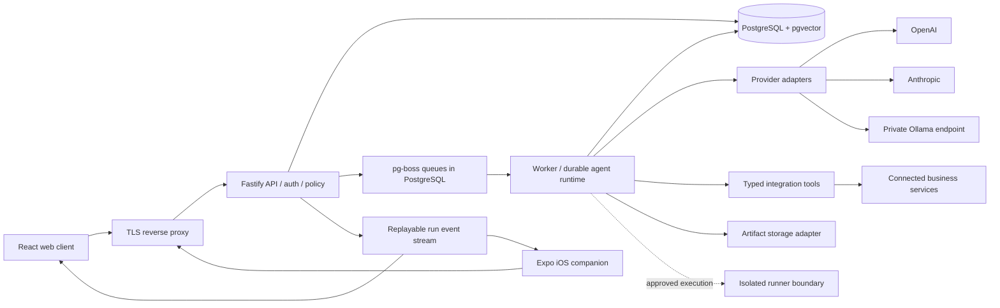

# Vuzmi architecture

Status: proposed architecture, updated with the founder's first answers. This is a design, not a statement that the capabilities below already exist.

Prepared: 4 November 2026. Initial audience: SaaS founders building, operating, marketing and selling their products. Delivery target: a polished, deployable self-hosted, single-organisation alpha within one week. Public multitenant SaaS and autonomous operation are later release gates. The source code for both deployment modes is intended to be open; the founder selected AGPL-3.0-only on 4 November 2026.

Confirmed constraints: the MacBook M5 and local Ollama are the testbed; later infrastructure is CPU-only with ample CPU/RAM and resource issues go to [XeoNote/Infrastructure-](https://github.com/XeoNote/Infrastructure-/); no additional spending beyond the existing GPT subscription; the private evaluation request was posted with founder authorization on 5 November 2026 as [issue #310](https://github.com/XeoNote/Infrastructure-/issues/310); `vuzmi.com` DNS is managed in Cloudflare. Do not provision paid services, purchase API credits or assume free-tier eligibility. Ollama is the first runtime provider; cloud providers remain disabled by default. An existing subscription may have an official eligible access/credit mechanism, but account eligibility and permitted integration are unverified. Only documented official authentication is in scope, never extracting or reusing another application's tokens.

## 1. Architectural direction

Vuzmi is one business control plane with a shared execution engine. Development, operations, support, marketing and sales are domain modules using the same agents, knowledge, integrations, approvals and audit trail. They should not become five independent agent products.

Start with a TypeScript modular monolith, deployed as an API process and a worker process. Use a React/Vite web client and an Expo/React Native iOS companion against the same versioned API. PostgreSQL stores business data, run state, events, the job queue and vectors. Keep networked dependencies few enough that a user can understand and restore a self-hosted installation.

The alpha demonstrates a complete business workflow with durable state and reviewable effects. A view with sample data must explicitly say it is a demo. Empty or disconnected modules show their real state.

### Immediate scaffold versus deployable alpha

The implemented local foundation now includes shared run/approval contracts, Fastify API, React web interface, native local Ollama adapter, PostgreSQL migrations/repository, and a separate pg-boss worker. Live generation creates a proposed document for exact-content approval, then saves a local artifact. Simulation remains an explicit option, with a JSON adapter available for dependency-free UI development. These are document workflows; no integration tools, repository inspection, retrieval, or autonomous business effects are enabled. See [STATUS.md](STATUS.md) for verification evidence.

The deployable alpha still requires authentication, grounded retrieval, the complete release package/outbox workflow, operational packaging, and restore evidence. The sections below describe this target unless marked otherwise. Initial sandboxed network checks could not establish service readiness; a later unrestricted loopback check found the user's Ollama service already running on 11434. The local helper leaves that service untouched and runs a dedicated cloud-disabled Ollama daemon on 11435 plus native PostgreSQL 16 on 55432. Docker is not needed for this local milestone; container/self-host packaging remains a release gate.

Implementation refinement: `packages/runtime` currently contains both repository/migrations and worker code. There is no separate `packages/db` until that split serves a concrete need. The private development application role owns its tables for bootstrap; restricted runtime roles and RLS remain requirements before multi-tenant hosting. Current routing is explicit eligible-model selection, not performance optimization or cloud-provider support.



Arrows are logical dependencies. API and worker share domain code and a database, but can scale and restart independently. Ollama is optional and normally remains on the operator's private network. The runner is a separately restricted execution surface, never code evaluated inside the API process.

## 2. Components and repository boundaries

| Proposed location       | Responsibility                                                                                             | Dependency rule                                                                                          |
| ----------------------- | ---------------------------------------------------------------------------------------------------------- | -------------------------------------------------------------------------------------------------------- |
| `apps/web`              | React/Vite interface, routing, command palette, queries and run event rendering                            | Uses API contracts; cannot import database or provider credentials                                       |
| `apps/api`              | Fastify HTTP routes, authentication, input validation, tenancy, admission control and SSE                  | Calls domain services; does not execute long agent loops                                                 |
| `apps/worker`           | Queue consumers, run advancement, ingestion, retries and reconciliation                                    | Uses domain/runtime packages; no public HTTP surface                                                     |
| `apps/mobile`           | Expo iOS companion: activity, run details, approval inbox and cancel controls                              | Shares contracts/tokens; mobile layouts are purpose-built                                                |
| `packages/core`         | Initial runtime-validated contracts, workflow types, pure state transitions and deterministic route policy | No framework, database, network or secret dependencies; split contracts/domain packages only when useful |
| `packages/db`           | SQL migrations, transaction helpers and repositories                                                       | Tenant context required for tenant-owned access                                                          |
| `packages/runtime`      | Bounded agent loop, step state machine, budgets and tool policy                                            | Provider and connector interfaces, no UI concerns                                                        |
| `packages/providers`    | Native OpenAI, Anthropic and Ollama transports                                                             | Normalises capabilities and events while retaining required opaque continuation state                    |
| `packages/integrations` | Typed connectors, webhook verification and tool implementations                                            | Effects require runtime authorisation and operation identity                                             |
| `packages/ui`           | Web primitives and shared design tokens                                                                    | Shares tokens with mobile; does not force DOM components into React Native                               |
| `packages/config`       | Validated environment and deployment configuration                                                         | Never serialises server secrets into clients                                                             |

These are boundaries to create as they become useful, rather than a requirement to populate empty packages immediately. Use a workspace package manager and a lockfile. Choose and pin supported Node, PostgreSQL and package versions at implementation time; record their support requirements in the development guide.

## 3. Domain modules

| Module                     | Owns                                                                      | First useful behaviour                                                             |
| -------------------------- | ------------------------------------------------------------------------- | ---------------------------------------------------------------------------------- |
| Workspace and access       | Organisation settings, membership, roles and policies                     | Bootstrap one owner; no public signup in the alpha                                 |
| Agents                     | Versioned instructions, tool permissions, memory scope and route profile  | Configure an agent and inspect the effective permissions                           |
| Runs and workflows         | Versioned workflow definitions, steps, events, budgets, approval waits    | Trigger, observe, approve, cancel and retry a bounded run                          |
| Model control              | Provider connections, model capability registry, routing and usage        | Health-check configured providers and explain a route decision                     |
| Knowledge                  | Sources, document versions, chunks, embedding profiles and retrieval      | Upload text/Markdown, ingest, retrieve and cite                                    |
| Memory                     | Explicit agent facts, preferences, decisions and summaries                | Inspect, correct, expire and delete scoped memory                                  |
| Integrations               | Connections, encrypted credentials, webhook receipts and tool manifests   | One real connector for the chosen vertical slice                                   |
| Support                    | Tickets, messages, classifications, response drafts and source references | Next workflow template: draft a cited answer and wait for approval before sending  |
| Development and operations | Repository/environment references, incidents and change proposals         | Read status and propose a patch or remediation; execution follows runner readiness |
| Marketing                  | Campaign briefs, audiences, assets and publication proposals              | Generate a reviewable campaign draft using approved knowledge                      |
| Sales                      | Contacts, companies, opportunities and activity proposals                 | Prepare a next action and record an approved activity                              |
| Commercial operations      | Plans, entitlements, metering and billing reconciliation                  | Deferred from initial alpha; source remains part of the same project               |

The workflow engine provides shared mechanics. Domain modules own business rules: support reply authorisation is not interchangeable with deployment authorisation.

## 4. Data model and invariants

Use opaque UUID identifiers, UTC timestamps and explicit schema versions. Every tenant-owned row has a non-null `workspace_id`, including queue payload references, events, artifacts, knowledge chunks and usage records. Single-organisation alpha is a deployment restriction, not permission to omit workspace boundaries.

| Entity group | Principal records                                                                                       | Important invariants                                                                                         |
| ------------ | ------------------------------------------------------------------------------------------------------- | ------------------------------------------------------------------------------------------------------------ |
| Identity     | `users`, `workspaces`, `memberships`, `sessions`                                                        | Membership is authoritative; role changes invalidate applicable sessions/permissions                         |
| Policy       | `workspace_policies`, `agent_versions`, `tool_grants`                                                   | Runs bind immutable agent/policy versions; current permission is rechecked before an effect                  |
| Providers    | `provider_connections`, `model_profiles`, `route_profiles`                                              | Credentials are encrypted; capability claims have verification timestamps                                    |
| Runtime      | `workflow_versions`, `runs`, `run_steps`, `run_events`                                                  | Every state transition is transactional; event sequence is monotonic within a run                            |
| Effects      | `tool_invocations`, `effect_operations`, `approvals`, `outbox`                                          | Unique operation key; argument hash and approval version must match before execution                         |
| Knowledge    | `sources`, `documents`, `document_versions`, `chunks`, `embedding_profiles`, `ingestion_jobs`           | Chunks retain source/version provenance and access scope; an embedding space never mixes incompatible models |
| Memory       | `memory_items`, `memory_revisions`                                                                      | Explicit scope, provenance, trust state, expiry and deletion lifecycle                                       |
| Business     | `tickets`, `ticket_messages`, `contacts`, `companies`, `opportunities`, `campaigns`, `change_proposals` | Connector external IDs are unique within workspace and connection                                            |
| Integrations | `integration_connections`, `webhook_receipts`, `sync_cursors`                                           | Deduplicate external events; no implicit cross-workspace credential reuse                                    |
| Operations   | `artifacts`, `usage_ledger`, `audit_events`                                                             | Artifact access checked on download; observed usage separated from estimated cost                            |

Use composite foreign keys such as `(workspace_id, run_id)` referencing `(workspace_id, id)`. This prevents an otherwise valid record ID from attaching one tenant's object to another tenant's row. Add indexes beginning with `workspace_id` for primary tenant access paths. Use optimistic versions on editable records and approval targets.

Events are an append-only audit and replay surface within a retention window. Relational state is the transactionally maintained read model. This design is not a promise to implement full event sourcing or rebuild every table from events.

## 5. API and event contracts

Expose JSON HTTP endpoints under `/v1`. Publish OpenAPI from the same runtime-validated contracts used by the server. Business mutations return persisted resource state; long operations return `202` with a run or job ID. Validate JSON schemas, pagination bounds, uploads and filters server-side.

| Surface           | Proposed endpoints                                                                                           |
| ----------------- | ------------------------------------------------------------------------------------------------------------ |
| Session/workspace | `GET /v1/me`, `GET /v1/workspace`, `PATCH /v1/workspace`                                                     |
| Agents/workflows  | `GET/POST /v1/agents`, `GET/PATCH /v1/agents/:id`, `GET/POST /v1/workflows`                                  |
| Providers         | `GET/POST /v1/provider-connections`, `POST /v1/provider-connections/:id/test`, `GET /v1/models`              |
| Runtime           | `POST /v1/runs`, `GET /v1/runs`, `GET /v1/runs/:id`, `POST /v1/runs/:id/cancel`                              |
| Run inspection    | `GET /v1/runs/:id/events`, `GET /v1/runs/:id/steps`, `POST /v1/runs/:id/retry`                               |
| Approvals         | `GET /v1/approvals`, `POST /v1/approvals/:id/decisions`                                                      |
| Knowledge/memory  | `GET/POST /v1/sources`, `POST /v1/documents`, `POST /v1/retrieval/search`, `GET/PATCH/DELETE /v1/memory/:id` |
| Business records  | Ticket/contact/opportunity/campaign endpoints as their slice is implemented                                  |
| Integrations      | Configuration routes restricted to administrators; signed inbound `/v1/webhooks/:provider/:connectionId`     |
| Operations        | Public minimal liveness; restricted readiness, metrics and version endpoints                                 |

`POST /v1/runs` and external-effect mutations accept an `Idempotency-Key`. Scope it to workspace, actor and operation; persist the request hash and response. A reused key with different input is a conflict. Retries create a new attempt record, not an invisible rewrite of a completed history.

Event envelope:

```ts
type RunEvent = {
  schemaVersion: 1;
  id: string;
  workspaceId: string;
  runId: string;
  sequence: number;
  occurredAt: string;
  type: string;
  payload: unknown; // Discriminated, runtime-validated schema per event type.
};
```

Initial types: `run.queued`, `run.started`, `route.selected`, `step.started`, `message.delta`, `message.completed`, `retrieval.completed`, `tool.proposed`, `approval.requested`, `approval.decided`, `tool.completed`, `tool.failed`, `usage.recorded`, `run.paused`, `run.cancelled`, `run.failed`, `run.completed`.

Serve SSE with a monotonically ordered event cursor and resume from `Last-Event-ID`. Persist meaningful progress and bounded text batches rather than one database row per token. An interrupted generation attempt is marked superseded before another attempt streams; clients must not concatenate two attempts as one answer. Reconnection recovers persisted state, not guaranteed delivery of every ephemeral token.

Use one origin behind the reverse proxy for web/API cookies. Browser streams use authenticated same-origin sessions; do not put bearer tokens in URLs. Mobile uses its API access token through a streaming fetch client, with cursor-based polling as a fallback. SSE consumers recheck permissions and stop promptly on revocation.

## 6. Durable execution, retries and idempotency

pg-boss provides PostgreSQL-backed queueing, scheduling, retries and transactional enqueue support. It is not the agent state machine. Vuzmi owns durable run and step records, inputs/outputs, approval waits, attempt numbers and effect operations. [Queue reference](https://github.com/timgit/pg-boss)

Run states: `queued -> running -> waiting_approval | waiting_retry | paused -> running -> completed | failed | cancelled`. Waiting and paused states have persisted reasons and do not retain a worker process or open database transaction. Steps have `pending`, `running`, `waiting`, `succeeded`, `failed`, `cancelled` and `superseded` states.

1. Admission validates caller, workflow version, tool grants, provider policy and budget. In one database transaction, insert the run, initial event and queue job/outbox entry.
2. A worker claims a job and advances one bounded step using a lease and optimistic version. Long network calls run outside database transactions. Heartbeats extend valid leases; expired attempts are recovered by a reconciler.
3. Persist the completed model response or tool proposal before scheduling its successor. Reuse successful step output on recovery rather than asking a model to repeat a completed decision.
4. Treat each network effect as potentially repeated. Allocate a stable `effect_operation_id` before calling the external service and forward it as a provider idempotency key when supported.
5. If a timeout leaves an effect outcome unknown, reconcile by provider operation ID or external resource lookup. If reconciliation is impossible, mark `outcome_unknown` and require review; do not blindly repeat a send, payment or deployment.
6. Commit state, events, budget ledger updates and next work atomically. A transactional outbox covers integrations that cannot share the queue transaction.
7. Cancellation persists an intent and prevents new steps. Abort in-flight network work when supported; a completed external action may still require a domain-specific compensating operation.

Approval records bind actor, workspace, action kind, exact argument/content hash, target version, expiry and policy version. Approving a draft does not authorise later edited text. At dispatch, recheck current role, integration permission, approval expiry, target version and limits. A durable timer or queue deferral resumes expired approval handling.

Bound every run by maximum steps, tool calls, wall-clock deadline, concurrent children, input/output tokens and spend reservation. Distinguish estimated reservations from observed provider usage. Serialise or atomically reserve concurrent budget consumption. Retries use exponential backoff and jitter for transient failures, respect rate limits, and end in a visible dead-letter/review state.

Do not claim exactly-once external effects. Database uniqueness can guarantee one local operation record; external service semantics and reconciliation determine the practical effect guarantee.

## 7. Provider contracts and automatic model selection

Use official/native APIs behind a small Vuzmi interface. OpenAI uses Responses; Anthropic uses Messages; Ollama uses its native chat endpoint. Their tool and streaming schemas differ. Anthropic tool results reference a `tool_use` ID and must follow its tool-use message; Ollama accepts tool definitions and model-dependent capabilities; OpenAI returns typed function-call items and streaming events. [OpenAI tools](https://developers.openai.com/api/docs/guides/function-calling), [OpenAI streaming](https://developers.openai.com/api/docs/guides/streaming-responses), [Anthropic lifecycle](https://platform.claude.com/docs/en/agents-and-tools/tool-use/handle-tool-calls), [Ollama chat](https://docs.ollama.com/api/chat)

```ts
interface ModelProvider {
  healthcheck(connectionId: string): Promise<ProviderHealth>;
  listModels(connectionId: string): Promise<ModelProfile[]>;
  generate(request: GenerationRequest): AsyncIterable<GenerationEvent>;
  embed?(request: EmbeddingRequest): Promise<EmbeddingResult>;
}
```

Contracts carry an abort signal, timeout, capability requirements, content blocks, tool schemas, output limits and provider/model identity. The normalised event set contains text deltas, complete tool calls, completion/stop reason, usage and typed errors. Parse complete tool input and validate it before dispatch; streaming partial JSON never triggers an effect. Provider adapters preserve opaque continuation material needed for correct tool-loop replay, encrypt it at rest, and do not expose it as an agent's private reasoning in the interface.

The model registry records provider/model ID, configured context/output limits, tool/structured-output/vision capabilities, locality, health, pricing snapshot, and last verification. Discovery is best-effort; an administrator can add an explicit model ID. Connectivity is not proof of tool reliability: the connection test includes a small capability probe when the user enables tools.

Routing order:

1. Apply hard constraints: workspace and workflow policy, data classification, local-only restriction, allowed providers, required modalities/tools/schema, context capacity and remaining budget.
2. Among eligible healthy models, select by the configured profile (`local`, `economy`, `balanced`, `quality`, or pinned model). Initial policy is deterministic rules with administrator-supplied quality tiers and observed latency, not an untrained autonomous optimiser.
3. Record candidate exclusions, selected model, policy version, price assumptions and a plain-language reason in `route.selected`.
4. Permit fallback only within the same hard constraints and only at a safe model-step boundary. Local-only never silently falls back to a cloud model. Under the current zero-additional-cost constraint, cloud requests and automatic cloud fallback are disabled; configuring an API key does not grant permission to spend. An unavailable qualifying model produces an actionable blocked state.
5. Never execute the same proposed tool twice because a model was switched. Preserve completed effects and reconstruct a valid new provider conversation from approved business state when changing providers.

Start with text and client-side function tools. Advanced provider-specific hosted tools, audio, computer use, server-managed agent state, provider-native file stores and distributed multi-agent delegation are later capabilities. Keep Vuzmi's durable state and knowledge portable across providers.

## 8. Memory and RAG are different lifecycles

RAG stores reference material; memory stores explicitly scoped observations or decisions learned during work. Neither is a substitute for authoritative business records.

Knowledge lifecycle: register source -> fetch/upload -> validate -> parse -> immutable document version -> deterministic chunks -> embed with a versioned embedding profile -> mark searchable. Keep source URL or artifact ID, content hash, parser/chunker version, timestamps and access scope. Alpha accepts bounded text/Markdown uploads; PDF, mail, website and repository ingestion are separate connectors added with appropriate parsers and limits.

Retrieve only after applying workspace and collection/document access controls. Use PostgreSQL full-text search plus vector similarity, combine ranks, then provide bounded chunks with stable citation IDs. Start with exact similarity over the filtered alpha corpus; introduce HNSW after measuring corpus size and recall. Approximate indexes can return fewer results under filters, so benchmark tenant-filtered recall and configure iterative scans when adopted. [pgvector reference](https://github.com/pgvector/pgvector)

Treat source text as untrusted data. Retrieved instructions cannot expand agent permissions or select secret-bearing tools. Record the exact document versions used by a run. Do not present similarity scores as calibrated factual confidence; ask for clarification or decline to invent an answer when sources are insufficient.

Embedding profiles bind provider, model, dimension, normalisation and version. A model change creates a new index generation and re-embedding job; switch collections atomically after successful validation. Do not compare query vectors from one model with document vectors from another. Failed ingestion is visible and retryable; unchanged hashes are skipped.

Memory items carry workspace, owner/agent/project scope, type, value, provenance, trust (`proposed`, `confirmed`, `rejected`), creation/update/expiry times and sensitivity. Agents propose durable memories; policy controls which types can be auto-confirmed. Preferences or operational decisions affecting external actions require confirmation. Users can inspect, edit, reject and delete memory. Conversation summaries are versioned aids and retain links to their source events; they are not unquestioned instructions.

Deletion removes a source or memory from live retrieval immediately, then removes chunks, embeddings and artifacts through an auditable cleanup job. Document backup-retention effects and ensure restoration reapplies deletion tombstones. Do not leave deleted text embedded in unrestricted debug logs or caches.

## 9. Authentication, RBAC and tenant isolation

Use a maintained authentication implementation rather than writing password or token cryptography. The alpha has an explicit one-time owner bootstrap and disabled public registration. Web uses secure, HttpOnly, SameSite cookies, CSRF protection on cookie-authenticated mutations and short-lived sessions. Mobile uses a supported authorisation flow with PKCE, short-lived access tokens and rotated refresh tokens held in iOS secure storage. Choose and verify the concrete auth package when implementing this milestone. OIDC/SSO is a later connector, not a separate identity system.

Proposed roles: owner (workspace and access administration), administrator (providers/integrations/policies), operator (run and approved domain actions), approver (specific effect classes), viewer (read only). Permissions are explicit capabilities such as `run:start`, `run:cancel`, `support:send`, `deploy:approve`, `integration:manage`. Role labels alone must not grant every external tool. Agents receive narrower capability grants and scoped connection/resource access, independent of the initiating user's broad account role.

The API derives workspace membership from authenticated identity. Never trust a workspace ID supplied by a client without checking membership. Workers and webhook consumers must establish tenant context before resolving domain IDs. Run database requests in a transaction with server-assigned `SET LOCAL` tenant context, and use RLS on tenant-owned tables as defence in depth. The runtime database role must not be a superuser, table owner or have `BYPASSRLS`; migrations use a separate role. Use `FORCE ROW LEVEL SECURITY` where applicable and tenant-scoped composite foreign keys. PostgreSQL explicitly permits privileged roles/owners to bypass ordinary RLS, so test with the real application role. [PostgreSQL RLS](https://www.postgresql.org/docs/current/ddl-rowsecurity.html)

RLS is not sufficient by itself. Object storage paths, signed downloads, queue consumers, full-text/vector retrieval, exports, search caches, audit routes and connector credentials need the same scope checks. Before multitenant SaaS, add automated adversarial cross-tenant tests for every API and asynchronous boundary, privilege review, rate/fairness limits and a tenant-deletion/restore procedure. Do not enable public multi-organisation signup merely because `workspace_id` exists.

## 10. Integration and runner trust boundaries

Integration tools have a typed manifest: name/version, JSON input/output schemas, required capabilities, resource scope, effect class (`read`, `draft`, `write`, `destructive`), idempotency support, timeout and egress requirements. The runtime authorises each call before dispatch. A model-generated string cannot select arbitrary code, shell arguments, URLs or credentials.

Verify inbound webhook signatures against the raw request body, reject stale/replayed events where supported, deduplicate event IDs and acknowledge only after durable receipt. Resolve the connection's workspace server-side. Refresh-token operations are locked per connection; credential expiry and revoked permissions surface as connection failures.

Provider URLs and website ingestion create SSRF risk. In hosted SaaS, normal connectors must reject loopback, private, link-local and cloud metadata destinations and revalidate redirects/DNS resolutions. Private infrastructure is reached through an explicit paired connector. Self-hosted administrators may allowlist private Ollama/infrastructure endpoints; this is an operator setting, never a model-controlled escape hatch.

For code execution, use an explicit runner protocol with per-job inputs/artifacts, a short-lived scoped token, job lease, cancellation, output limits and signed identity. A self-hosted runner starts non-root disposable containers with no privileged mode, no host Docker socket or arbitrary mounts, a read-only base filesystem, a temporary working volume, dropped Linux capabilities, resource limits and network-deny by default. Only broker narrowly scoped repository credentials for the job. Docker daemon control is host-level authority and cannot be exposed to the API. [Docker security](https://docs.docker.com/engine/security/), [rootless operation](https://docs.docker.com/engine/security/rootless/)

Containers alone are not the complete isolation design for hostile hosted code. Before SaaS accepts untrusted code execution, add a stronger isolation boundary such as a microVM or hardened sandbox on dedicated runner nodes, plus validated egress and artifact handling. Separate customer jobs and never share writable working directories.

Alpha development/operations can read repository/status data and prepare reviewable patches. Run commands only when an actual isolated runner is available and the tested policy permits them. Initial 4 November observation: Docker was installed without a working daemon. Subsequent local Ollama generation and embeddings on the dedicated11435 service are verified in STATUS.md. The development increment below introduces a separately provisioned isolated runner; runner readiness must be verified independently. Do not silently run code on the host or switch to a paid provider as a fallback.

## 11. Privacy and secrets

Store provider/integration secrets only server-side. Encrypt database-held secrets using authenticated encryption with key version metadata; keep the master key outside the database and source control. Hosted SaaS should use the infrastructure team's existing approved key-management service where available; selecting a new paid KMS is outside the current budget. Never return a saved secret to the browser, include it in run arguments, or expose it in traces. Rotate credentials and encryption keys with an audited rewrap path.

Apply data classifications to sources, memory, runs and artifacts. The default alpha route is configured explicitly; local-only is enforced on both generation and embedding. A local model does not make a workflow local if a later tool sends the same information to another service. Before external effects, apply destination and data-scope policies.

Use `store: false` for OpenAI Responses by default and retain Vuzmi's own necessary execution history. That setting does not assert zero provider retention: abuse-monitoring and feature-specific policies remain relevant. Anthropic retention also varies by arrangement, model and feature. Display providers/destinations, log a route audit and document current provider controls; do not promise universal zero retention. [OpenAI data controls](https://developers.openai.com/api/docs/guides/your-data), [Anthropic data retention](https://platform.claude.com/docs/en/manage-claude/api-and-data-retention)

Redact request headers, secrets, message bodies and retrieved content from default operational logs. Content-bearing run history is access-controlled application data with configurable retention. Disable optional external telemetry by default in self-hosting. Export/deletion must cover knowledge, memory, conversation content, artifacts and connector-derived data, while retaining only minimal non-content audit records where the operator's policy requires them.

## 12. Self-hosting and future SaaS

Self-hosted alpha topology: TLS reverse proxy/static web serving, API, worker and PostgreSQL/pgvector; artifact storage starts as a persistent private local volume behind a storage interface. Ollama is an optional separately managed service. A Compose deployment should have health checks, persistent volumes, migration commands, validated config, explicit upgrade steps and no production default passwords. Keep PostgreSQL and provider endpoints private.

Serve iOS and web through a user-configurable backend URL. On an iPhone, `localhost` is the phone, and inside an API container it is the container. Provider connectivity is from the backend/connector, not from either client. Document supported host/network mappings rather than exposing unauthenticated Ollama to the internet.

Hosted SaaS uses the same core API/worker/domain code on existing infrastructure, with centrally operated PostgreSQL and tested backups, private artifact storage, protected keys, ingress controls, per-workspace quotas, separate runner pools and a billing adapter. Infrastructure ownership and capacity must be agreed with the existing team; no new paid managed service is assumed. It does not require Kubernetes for the first hosted cohort. Multi-region orchestration and database sharding are deferred until measured requirements justify them.

A hosted server cannot directly reach a customer's `localhost` Ollama or private network. The planned connector maintains an authenticated outbound connection or polls for scoped jobs, advertises capabilities, receives expiring leases, stores local credentials locally and returns only allowed results. Use explicit pairing/revocation and mTLS or equivalent device identity. This connector is a later delivery item; the alpha supports Ollama reachable from its self-hosted backend.

Billing remains a separate commercial module. Signed webhook receipts drive an entitlement ledger through idempotent reconciliation. Never use a client-side checkout success screen as proof of payment. Paid rollout requires confirmed pricing, licence, provider terms, support process, recovery checks and real billing integration; these decisions are not implied by this architecture.

Development inference may use the MacBook's Metal acceleration. Datacenter deployment must not depend on that acceleration: benchmark a suitable CPU model separately, keep inference behind the same provider contract, and package application services for the target Linux architecture. Do not extrapolate M5 latency to CPU-only servers.

## 13. Observability, backup and recovery

Propagate request, run, step, attempt and effect-operation IDs across structured logs and traces. Emit OpenTelemetry-compatible spans without prompt content by default. Track queue age, job retries/dead letters, active/waiting runs, step latency, provider error/rate-limit rates, token usage, estimated/observed cost, retrieval latency, ingestion lag, approval age, runner utilisation and database health. Add per-workspace quotas and metrics before hosted multitenancy.

UI status derives from persisted runtime state and real provider/integration checks. A degraded dependency should show the failed connection and remediation. Liveness means the process is alive; readiness means required backing services and migrations are ready. Workers expose a heartbeat visible to the API.

Alpha recovery targets, to validate rather than advertise as an SLA: RPO up to 24 hours with daily encrypted backups; RTO within four hours on the documented small deployment. Hosted targets should be selected after requirements, with point-in-time database recovery and measured restore drills. Back up PostgreSQL, artifacts and the encryption-key recovery material through separate protected paths; a database dump without its decryption key is not a recoverable installation.

Test restoration into an isolated environment. Verify migrations, tenant ownership, credential decryption, artifact access, retrieval, queue state and deletion tombstones. Restored pending writes start paused: reconcile external outcomes and operation IDs before dispatch to avoid replaying an action already performed after the backup. Document forward-compatible migrations, rollout ordering, retention, restore and key-rotation procedures. A backup job passing is not proof that restore works.

## 14. Week-one vertical slice and release gates

The first slice is founder release preparation: capture a product/release brief and project evidence -> retrieve workspace knowledge -> route to a verified local model -> prepare a development/operations change proposal plus release notes, marketing and sales drafts -> request approval -> place the approved, version-bound artifacts in a local export/outbox -> record the result, memory proposal and usage. The outbox is an internal prepared-action record, not proof that anything was published or sent. Demonstrate API/worker restart recovery and approval from the iOS companion. Support becomes the next template over the same runtime.

Definition of an honest alpha:

- Web control plane has functional provider settings, knowledge, agent/run inspection and approvals.
- OpenAI, Anthropic and Ollama adapter contracts have fixtures; live inference first proves the available Ollama runtime. Cloud calls stay disabled unless an official no-additional-cost route is explicitly verified and authorised. Report each configured provider's actual test status.
- A real local release workflow produces approved exported artifacts/outbox items. A remote paid connector is not a day-seven requirement. Any connected external effects respect idempotency and approval policy.
- A stopped worker can resume a run without silently duplicating an external action.
- The single-organisation deployment has real authentication, tenant-scoped repositories, backups and documented limitations.
- iOS companion can connect, inspect and decide approvals; an App Store release is a separate platform/distribution milestone.
- Tests cover budget enforcement, policy restrictions, interrupted provider streams, duplicate jobs/webhooks, approval version mismatches, deletion and scope boundaries.

Non-goals for this week: feature-complete CRM/helpdesk/marketing suite, arbitrary autonomous production changes, guaranteed reliable tools on every Ollama model, an app marketplace, collaborative visual workflow editor, public hostile-code execution, zero-retention certification, enterprise SSO, multiple regions, App Store approval or a fully autonomous SaaS sales machine. These remain roadmap outcomes with dependencies, not features concealed behind working-looking buttons.

## 15. Proposed architecture decisions

| ADR | Choice                                                         | Alternative and reason to defer                                                                                     | Revisit trigger                                                                              |
| --- | -------------------------------------------------------------- | ------------------------------------------------------------------------------------------------------------------- | -------------------------------------------------------------------------------------------- |
| 001 | TypeScript modular monolith with separate API/worker processes | Microservices add deployment, tracing and consistency costs before bounded contexts stabilise                       | Independent scaling or ownership demonstrated by measured bottlenecks                        |
| 002 | PostgreSQL + pgvector + pg-boss                                | Redis/vector service/queue cluster add operational dependencies                                                     | Measured queue or retrieval contention/scale exceeds one database's practical envelope       |
| 003 | Vuzmi-owned persisted step machine; pg-boss for delivery       | Temporal offers replay-based durable workflows but requires a production service and workflow-versioning discipline | Complex long-lived sagas, child workflows and compensation exceed the small explicit runtime |
| 004 | Native provider adapters with a portable tool/event contract   | Treating all providers as OpenAI-compatible loses important semantics                                               | Re-evaluate maintained abstraction libraries against contract tests; retain escape hatches   |
| 005 | React/Vite web, Fastify API, Expo iOS companion                | Native SwiftUI duplicates client expertise; a full mobile clone dilutes the first release                           | Native-only capabilities or mobile usage justify targeted native modules                     |
| 006 | Single organisation first; tenant IDs/RLS from the start       | Immediate public multitenancy expands the threat model and commercial surface                                       | Isolation tests, quotas, backup/deletion procedures and access review pass                   |
| 007 | Rule-based routing with explainable hard constraints           | Learned model routing needs reliable task evals and usage data                                                      | A representative evaluation set demonstrates useful quality/cost improvements                |
| 008 | Local artifact adapter behind a storage interface              | Mandatory object-store service complicates alpha setup                                                              | Hosted deployment or multiple API/worker machines require shared object storage              |
| 009 | Isolated runner boundary; no host execution fallback           | Direct shell access to the API host collapses privilege boundaries                                                  | Enable only after runner policy and isolation verification pass                              |

Temporal's replay model is well suited to durable workflows, but its production deployment includes a Temporal Service in addition to application workers; operating that service is a deliberate tradeoff. [Workflow model](https://docs.temporal.io/workflows), [deployment](https://docs.temporal.io/production-deployment), [self-hosting considerations](https://docs.temporal.io/self-hosted-guide/production-checklist)

## 16. Open decisions and material risks

- First buyer and initial journey are confirmed: SaaS founders, build -> operate -> market -> sell. Refine the first release-preparation acceptance example and the later support template.
- Confirm desired autonomy, approval classes, iOS distribution, and exact deployable-alpha acceptance evidence. The M5 local testbed and CPU-only infrastructure issue destination are confirmed; downloading suitable models is permitted.
- Verify whether the existing subscription qualifies for any official subscription-backed API credits or Sign in with ChatGPT integration before enabling cloud inference. Neither account eligibility nor an allowance is assumed, and no paid top-up is authorised.
- AGPL-3.0-only and public publication at Ether-X-UK/Vuzmi are selected. Pricing and support commitments remain founder decisions.
- Model capabilities, availability, pricing and provider data policies change. Store configuration versions and verify supported behaviour rather than hardcoding a fashionable model as universal.
- A hand-built durable step machine is manageable only while narrowly bounded. Resist adding arbitrary DAGs and distributed subagents before the recovery semantics are tested.
- The database is a shared resource across queues, vectors and business records; bound ingestion, queue polling and expensive queries and measure contention.
- Generated code and retrieved content are untrusted inputs. External effects require deterministic policy checks independent of model judgement.
- One week can deliver an attractive and useful foundation with one real slice. Production SaaS readiness depends on validated security, recovery, provider access, commercial decisions and live integration evidence.

Evidence and source review are maintained in [RESEARCH.md](./RESEARCH.md).

## 17. Knowledge implementation increment

The next local slice uses pgvector exact similarity plus PostgreSQL full-text search, scoped before ranking. Native PG16 lacked the extension; install pinned official pgvector v0.8.7 against that server rather than upgrading the user's database. The helper enables the extension as its private cluster administrator. Application migration v1 stays byte-identical; append checksum-validated v2.

Bounded UTF-8 text/Markdown (64 KiB per source) is versioned and deterministically chunked. A separate durable indexing queue embeds outside transactions and atomically activates a complete revision, fenced by source revision, attempt, and tombstone. Source IDs and revision references alone enter jobs. Failed or superseded indexing cannot publish partial chunks. The local embedding profile pins Ollama model `embeddinggemma:300m`, its observed digest, dimensions, L2 normalization, API version and retrieval prompt version. Query/document profiles must match; no embedding fallback or automatic profile migration is permitted.

Mission knowledge is opt-in and required once selected. Admission pins source and memory revisions. The worker retrieves only those active source revisions and explicitly selected, confirmed, unexpired workspace memories. Insufficient evidence is persisted and stops generation; changed/deleted selections fail instead of substituting newer context. Persist immutable excerpts/citation identities in the run, and recheck selected revisions before accepting generated output. Ranking scores are not factual confidence. Source excerpts are untrusted data and cannot grant tools or alter policy.

Memory is manually curated and workspace-scoped in this increment; raw conversations are not automatically retained as memory. Source-linked memory must refer to a real active source revision. Edits require the current memory revision. Agent/project memory scopes and automatic memory proposals remain later features.

Source deletion removes active originals, revisions, chunks, vectors, and source-linked memories, leaving a content-free tombstone against resurrection. **Historical run evidence and generated/approved artifacts remain retained in this private alpha.** The interface must disclose that exception before deletion; this is removal from active retrieval, not complete erasure across history or backups. Production deletion/retention and restoration tombstones remain release gates.

## 18. Private single-owner authentication increment

Use maintained Better Auth 1.7.17 with its matching Expo integration, PostgreSQL-backed sessions and a dedicated validated schema/pool. Lock and version library migrations and the Vuzmi wrapper schema. No public registration, social providers, external mail, or password reset delivery is enabled. A unique database index permits one user; that account is the owner of the single local workspace. Multi-user roles and hosted tenant membership remain future work.

Owner creation requires a one-time high-entropy setup key held in a private local file. Under a schema-scoped advisory lock and empty-user check, a private Better Auth instance performs signup/hashing with auto-sign-in disabled. The public instance disables signup and its HTTP adapter allowlists only implemented session/login/logout endpoints. Custom state/session helpers return safe owner fields, never session secrets. Better Auth's normal cookie protocol remains responsible for authentication transport. Setup does not verify email ownership or send mail.

Sessions are DB-backed with cookie cache disabled, HttpOnly/SameSite=Lax cookies, Secure over HTTPS, exact trusted origins, and prompt logout/revocation. HTTP auth is permitted only on loopback during development. Expo uses the maintained SecureStore cookie plugin and an exact app scheme. API workspace identity derives from the authenticated single owner, not a client-selected workspace. Approval records include the authenticated actor identity; legacy development decisions remain labelled local operator.

The server defaults to owner authentication. A conspicuous explicit development bypass is available only for loopback testing/simulation and is not deployable configuration. Test bootstrap/login/revocation against isolated schemas, never by seeding a known password into the operator's database. The operator chooses the actual owner credentials through the completed setup interface. Public exposure and infrastructure changes remain separate release decisions.

## 19. Local approved package and runnable self-host increment

The durable approved artifact already acts as the transactional local outbox. Expose a read-only package projection instead of creating a second independently committed queue. One stable JSON manifest contains the exact approved Markdown bytes and their own SHA-256, the original action-envelope fingerprint, approval revision/actor/time, route, usage, retained evidence, and events. Pending, rejected, corrupt, or foreign-workspace aggregates cannot export. Downloads do not dispatch anything. Additional generated files require their own pre-approval payload contract; do not fabricate assets by splitting or rewriting an approved document afterward.

For existing-hardware evaluation, the production command runs the API and worker without file watchers; the API serves only the built web root. Both remain bound to loopback. Owner auth is mandatory; explicit simulation/auth bypasses are refused by this command. Minimal liveness and database-worker readiness endpoints contain no owner or business data. This native package is independently runnable without Docker, EAS, or additional paid services. Network deployment, TLS/private ingress, restricted migration/runtime roles, encrypted off-host backups, and public exposure remain infrastructure/release gates. No infrastructure request or DNS change is executed by preparing the package.

## 20. Pinned founder workflow and source offer

New missions pin `founder-release@1`; legacy records retain an explicitly unknown workflow version. Its prepare/retrieve/draft/review/save view is derived from correlated persisted event sequences and actual evidence/decision/artifact state. It does not create a second mutable scheduler. A recorded draft or saved document never marks the proposed acceptance checks as executed. Insufficient retrieval blocks drafting; simulation explicitly assembles a deterministic template. Arbitrary workflow graphs and host/tool execution remain future work.

The approved package includes the workflow reference, with null for legacy history. The AGPL source offer uses a deterministic archive of clean committed HEAD. Packaging refuses dirty source, ignored/private tracked paths, submodule/export omissions and incomplete licence metadata. The API serves only the fixed reviewed archive after checking its revision, permissions, length and SHA-256; it cannot serve request-selected paths. A matching local source bundle is distinct from publishing a repository or authorizing network exposure.

## 21. Human draft revision increment — 5 November 2026

Observed local model wording errors make factual review necessary. Add owner-authored revisions before approval so the person can correct a draft without pretending the model regenerated it. This is a local document transition, never a tool call or release authorization.

A revision is allowed only for a waiting-for-approval Ollama proposal in the current canonical document format. The editor changes the body only: Vuzmi reconstructs its fixed human-revised/unverified provenance and the exact retained evidence appendix from the existing snapshot. Legacy/custom document formats remain readable and approvable but cannot be rewritten by guessing their structure. Simulation remains explicitly a deterministic template. Require valid selected citation IDs and retain at least one actual citation when evidence was required.

Every save submits an edit UUID, the displayed proposal fingerprint and aggregate revision, exact new body and a short reason. Trusted code derives the actor from the owner session, validates UTF-8/control-character bounds, constructs and fingerprints the revised full document, increments the aggregate revision and appends its edit event in the same transaction. Old fingerprints/revisions cannot authorize the new document. Approval and edits serialize on the same run lock; terminal proposals cannot change. An exact replay of an edit UUID is idempotent and a conflicting replay fails closed.

Retain the original proposal and subsequent prior proposals with actor, reason, event sequence, input/output revisions, request hash and next fingerprint. Verify the complete retained chain on reads and exports. Limit a run to ten amendments and bodies to64KiB; another mission is the explicit escape hatch. Prior drafts, edit reasons and evidence are part of retained private history and backups. No automatic erasure or silent replacement is implied. The approved package preserves the revision record alongside the exact finally approved document; observed model token usage still describes the original model call, not human work.

Web revision controls disable approval while unsaved changes exist, show the saved/new review boundary, preserve local edits on conflicts and require deliberate discard/reload. Session expiry hides protected content and stops polling while retaining the unfinished editing session only in memory for the same backend/owner; sign-out requires the discard guard. No browser storage or server save is implied by recovery. Native clients continue to review the canonical exact document and use the current fingerprint/revision; native editing is deferred. No credential, provider, source selection, evidence identity, route or workflow version changes through this endpoint.

## 22. Public source and repeatable checks — 5 November 2026

The founder authorized public AGPL publication at Ether-X-UK/Vuzmi. Keep the default branch and pull requests covered by a bounded GitHub Actions job using standard Ubuntu 24.04 hosted capacity, read-only repository permissions and commit-pinned official actions. Use Node 22 and the committed npm lockfile. Disable dependency cache and artifact uploads so the initial workflow adds no stored build products or paid capacity. Public standard runner usage is free under the current [GitHub billing documentation](https://docs.github.com/en/billing/concepts/product-billing/github-actions); repository visibility must remain public for that assumption.

The job runs strict typechecks, contract/unit/client tests, production web build, real PostgreSQL 16/pgvector integration, isolated native backup/restore, iOS JavaScript export and clean-HEAD source packaging. Build pgvector from the verified official v0.8.7 commit against PostgreSQL 16 tools. Each database fixture owns its temporary cluster; failed startup must still attempt shutdown before removing data. No operator credentials, model downloads, inference, deployment, external sends or private runners belong in these checks. A hosted Linux pass proves that fixture/build surface only; it does not replace actual CPU-model quality, native Xcode or allocated-target operational validation.

## 23. Native review recovery — 5 November 2026

Allow only one workspace refresh per active native connection at a time. A five-second polling interval must not invalidate a slower request before its twenty-second timeout can surface. Fence responses and errors by connection/session lifecycle, retain newer run revisions when merging responses, and invalidate protected work on disconnect or session expiry. Every protected request that observes a current-connection 401 must clear protected state and return to the owner gate, including detail reads, decisions and conflict recovery. An obsolete connection's response must not affect its replacement.

Bind native review to a proposal fingerprint and revision. If a newer proposal arrives while detail is open, stop decisions and require a deliberate review of the updated exact document before enabling them again. A decision already in flight keeps its captured fingerprint/revision and relies on the server compare-and-swap. This extends the existing approval contract; native editing, remote access and external actions remain outside the increment.

The same proposal-review boundary applies on web: polling and conflict recovery must not silently change the payload behind an enabled decision. Keep the reviewed snapshot separate from the latest received run. A changed waiting proposal blocks decisions until the replacement document is explicitly opened and acknowledged. Human edit recovery remains independent and must retain its existing unsaved-text protection.

## 24. Public GitHub knowledge import — 5 November 2026

Founder-selected increment; implemented and locally verified as recorded in STATUS.md. The first connector imports one Markdown/plain-text file from the owned public `Ether-X-UK/Vuzmi` repository at an explicit full commit. No repository checkout, commands, GitHub credentials, private repositories, writes, webhooks or automatic synchronization. Existing local embeddings and retrieval handle indexing; no new dependency or paid service.

The server makes bounded unauthenticated GET requests only to `https://api.github.com`, with fixed version `2026-03-10`, no cookies/authorization and redirects rejected. Validate repository numeric identity/public visibility, explicitly confirm its SHA-1 object format (other formats fail clearly), resolve the exact commit, traverse at most eight nonrecursive tree levels and accept regular blobs only. Symlinks, submodules, LFS pointers, binary/control content, malformed UTF-8/Base64 and unsupported extensions fail closed. Use a 15-second overall network deadline, bounded streamed JSON, a 64 KiB decoded-file cap, one active preview request and visible rate-limit cooldown without automatic retries. Never log upstream bodies. Git object SHA-1 verification includes the blob header; separate SHA-256 hashes identify raw and normalized text.

`POST /v1/knowledge/github/preview` accepts `{commit, path, title}` for the fixed repository. It returns `{previewId, expiresAt, fingerprint, title, format, text, origin}`. Preview text is exactly the normalized content that will be indexed: CRLF/CR to LF and outer whitespace trimmed, using the existing source limits. The origin records repository ID/name, commit/blob IDs, path, hash algorithm, raw and normalized byte counts/hashes, normalization version and fetch time. Preview creates no source or queue job. Keep at most eight expiring previews in memory for five minutes, scoped to the authenticated owner. Changing inputs invalidates the client preview.

`POST /v1/knowledge/github/import` accepts `{importId, previewId, fingerprint}`. First check the durable receipt for an exact replay, including after API restart; conflicting reuse fails. Otherwise require the exact live preview and recheck public repository identity before atomically saving source, immutable revision origin, index job and import receipt. The receipt prevents duplicate imports on uncertain retries. Deletion does not permit resurrection by replay. A new explicit import creates a separate source; there is no hidden refresh. Both endpoints use the existing owner authentication and trusted-origin mutation boundary.

Add an append-only migration, preserving existing migration checksums. Source detail exposes current origin; each revision retains its own origin. Imported sources are read-only in the ordinary source editor; deletion remains available. Retrieval copies revision origin into the retained evidence snapshot. Canonical reference appendices and outbox packages include origin only when present so legacy document bytes, fingerprints and reviewed artifacts remain unchanged. Source deletion removes active content/indexes; prior run evidence keeps its recorded attribution under the existing retention disclosure. Normalized line numbers are not represented as GitHub line anchors.

Primary protocol references: [Git objects](https://git-scm.com/docs/user-manual), [trees](https://docs.github.com/en/rest/git/trees), [blobs](https://docs.github.com/en/rest/git/blobs), [repository hash algorithm](https://docs.github.com/en/rest/repos/repos#get-the-hash-algorithm-for-a-repository), [API versions](https://docs.github.com/en/rest/about-the-rest-api/api-versions), [rate limits](https://docs.github.com/en/rest/using-the-rest-api/rate-limits-for-the-rest-api). Nonrecursive requests omit the `recursive` parameter entirely. Public visibility and a valid hash establish provenance, not factual truth or permission to execute instructions in the file.

Live import verification also exposed an exhausted retrieval budget yielding a one-character tail citation. Selection now stops before severely truncated fragments (remaining bytes below the lesser of 80 and the full candidate size), while complete short source/memory facts still fit. Existing retained evidence remains immutable.

## 25. Development change workflow — 5 November 2026

Founder-authorized increment, implemented and verified locally and on hosted Linux as recorded in STATUS.md: owner task/optional public Vuzmi issue → immutable code context → local structured code proposal → isolated baseline/candidate checks → exact human review → saved local patch package. The first real acceptance task repairs the web API client's unreadable401 session-expiry handling. This is a complete, deliberately narrow development profile, not arbitrary repository execution.

Add a separate versioned `development-patch@1` aggregate and `/v1/development` module in the existing control plane. Reuse workspace, owner, event and decision semantics; keep founder-release runs, native document approvals and existing outbox bytes unchanged. Add migration4, development aggregates/events, queue admission, runtime/attempt ownership and approved package persistence. Initial web development navigation has its own list/detail; native development review is deferred and these jobs never enter its document-approval endpoint.

The first immutable profile is `web-api-status-authority@1`: owned public Ether-X-UK/Vuzmi, full base commit `a7d088e4954f848da392eed91684dfb445d5ce45`, and the literal editable path `apps/web/src/api.ts`. Retain exact baseline text/SHA-256 and a profile manifest binding acceptance-check bytes, dependency lockfile/source identity, fixed command, resource policy and resolved image ID. Operator provisioning exports reviewed Git objects, not the live working tree or private files. Optional issue intake fetches and retains the current public issue title/body/identity with bounded unauthenticated fixed-origin GETs; no comments, writes or credentials. Manual briefs remain supported and are labelled as such.

Ollama returns strict JSON: a summary plus full-file replacements containing literal path, before-SHA-256 and exact content. Trusted code checks Unicode/control/UTF-8 bounds, exact path/hash, duplicates, unsupported operations and nonempty changes; it computes the canonical whole-file unified diff and candidate fingerprint. Models cannot choose commands, images, permissions, dependencies, tests or expanded paths. Local capability/context checks and cloud-disabled Ollama remain mandatory; no paid/cloud fallback. Evidence describes functional checks, not proof that generated code is safe.

Use a dedicated free Colima/Lima Docker VM on this Mac, without HOME mounts, port forwarding, SSH-agent forwarding, inherited custom templates, Rosetta or changes to the default Docker context. Explicit socket selection plus a private empty Docker configuration excludes inherited registry credentials. The API never receives Docker control; a separate trusted worker owns the runner. Provision dependencies/checks from reviewed source/lockfiles before candidate admission. No dependency installation follows model output. Candidate child images use a trusted local sealed base and a generated COPY-only Dockerfile; reject inherited ONBUILD/volumes, remote frontend/ADD/RUN, and inspect exact local image IDs. Candidate files are data during preparation; generated code executes only inside the isolated check container.

Each baseline/candidate check uses a fresh named container, exact image/entrypoint/argv, `--pull=never`, network none, non-root UID/GID, read-only root, all capabilities dropped, no-new-privileges, PID/memory/CPU limits, bounded noexec tmpfs, no host mounts/devices/sockets/published ports and no healthcheck. Verify effective configuration before start. Bound process time and stdout/stderr; retain exit/OOM/timeout/truncation, command and image identities. Require the sealed acceptance harness's expected test results as well as exit0. Baseline must reproduce the failure and candidate must pass; otherwise the run fails visibly and cannot be approved. No host execution fallback. A missing runner/image/policy blocks admission.

Queue effects are at-least-once. Persist attempt identity and owned execution names before starting effects; fence every stage/result by worker ownership, attempt, revision, candidate/profile hash and execution identity. Interrupted/unknown execution cannot become passed. Reconciliation stops only labelled owned resources before closing a stale attempt; do not automatically regenerate/retry unknown checks. Use bounded ownership/heartbeat rules, prevent duplicate active execution and ignore late completions. Backup restore quarantines development jobs and invalidates attempts/runtime readiness in addition to existing queues. Failed/expired jobs remain observable rather than stranded queued/running aggregates.

The approval fingerprint binds task/issue snapshot, base/context pins, allowed scope, exact candidate/diff, model identity/usage and profile plus baseline/candidate receipts and log hashes. Owner decisions use captured revision/fingerprint, serialize with state changes and replay idempotently. Approval atomically saves only that development package; rejection saves no approved package. The downloadable JSON includes its diff, manifest and observed evidence. The actual checkout stays unchanged; later application, PR creation, merge and deployment need their own concrete authorization.

Protocol references: [Colima profile flags](https://github.com/abiosoft/colima/blob/v0.10.3/cmd/start.go), [no-mount semantics](https://github.com/abiosoft/colima/issues/1533), [Docker execution controls](https://docs.docker.com/reference/cli/docker/container/run/), [build contexts](https://docs.docker.com/build/concepts/context/), [Ollama structured output](https://docs.ollama.com/capabilities/structured-outputs). A shared VM with these restrictions targets owned-repository alpha use; hostile multitenant execution requires a stronger dedicated isolation gate.

Observed acceptance refinement: the initial4B model produced invalid TypeScript twice, which the fixed checks rejected. Preserve each failed task. Configure the next development task's local default explicitly with `OLLAMA_DEVELOPMENT_MODEL` (falling back to the existing configured Ollama model when unset), independently of founder document missions. Admission displays and retains that exact model; changing the configured default never changes existing tasks or silently retries/falls back. This is an operator choice following observed failures, not an evaluated automatic model selector.

## 26. Reusable development snapshots and local branch application — 5 November 2026

Founder-authorized increment, implemented and locally verified as recorded in STATUS.md. Extend the existing development aggregate without rewriting historical profiles, packages, fingerprints or events. The repository remains the locally registered owned `Ether-X-UK/Vuzmi` checkout. A task can use an operator-provisioned immutable snapshot of an explicitly selected clean full commit rather than the historical 401 exercise. No request or model can register an arbitrary repository, command, image, dependency or filesystem path.

Retain `web-api-status-authority@1` byte-compatible. Add `web-client-regressions@1`, with the existing regular TypeScript source paths `apps/web/src/api.ts`, `apps/web/src/proposalReview.ts` and `apps/web/src/draftSession.ts`. These are the complete editable scope; replacements may change a nonempty subset. Provision reviewed Git objects and committed offline fixture tests into a sealed image. Bind full base commit, exact file bytes/hashes, trusted test bytes/names, lockfile, fixed command, image and existing isolation policy in the profile fingerprint. Require a passing baseline and passing candidate for this profile. Those results establish the named regressions only: they do not establish that an arbitrary brief was fulfilled, full repository checks passed, or generated code is safe. Test/manifests/dependencies remain read-only and extra files, duplicate/no-op replacements and invalid Unicode/control/size input fail closed.

Provisioning is an explicit trusted local command, with bounded commit/profile choices and no model output in its inputs. Keep immutable private profile configurations addressed by SHA-256 and a bounded catalog with a default selection. Reprovisioning must not remove the images/configuration needed by queued or retained tasks. A worker advertises fresh verified catalog entries; admission captures the displayed profile hash and task request UUID. A changed/missing profile rejects admission instead of silently retargeting it. The worker receives the run's exact pinned profile and verifies it against the retained registry before baseline/candidate execution. Preserve the existing container policy, leased attempt fences, unknown-outcome handling and no-host-execution/no-cloud-fallback behavior.

The local Ollama full-file protocol remains versioned and strict, with aggregate context/output budgets for several files. Supply each permitted file as readable untrusted text and its exact before hash. Trusted code materializes deterministic diffs and fingerprints, checks every returned path/hash, and rejects scope expansion and empty changes. The original profile retains its historical task-specific instructions; the reusable profile uses the owner's brief and named regression obligations without injecting the old 401 repair. A model cannot infer new permissions from a task or issue.

Saving a development package continues to mean only saving that exact approved artifact. Add a separate application plan/operation/receipt, linked by run ID, package SHA-256 and the exact candidate/profile fingerprints. Only completed approved packages with verified integrity can request application. The plan names the registered repository, pinned base, exact changed file hashes and the fixed local destination `refs/heads/vuzmi/development/<run UUID>`. Its fingerprint and scope are displayed for a separate authenticated owner acknowledgment and authorization; an existing package approval never grants this effect.

Persist authorization, actor, timestamp, request identity and plan fingerprint before any Git effect. A trusted worker uses Git plumbing with fixed argv, a scrubbed environment, disabled hooks/global configuration/replacements and a private temporary index. It writes candidate blobs as data, builds a tree from the pinned base, verifies that only the approved regular-file entries differ, creates a deterministic child commit, and compare-creates the fixed branch with an absent-ref expectation. It never checks out generated code, runs hooks/builds on the host, changes the active index/worktree/branch, moves an existing branch, pushes, creates a PR, merges or deploys. Repository registration and object/ref format are rechecked at the effect boundary. Git metadata writes are a separately authorized local effect, not model execution authority.

Serialize application per run and retain one stable operation. Exact request retries return it; conflicting input/owner/plan or an occupied unrelated branch fails. A crash after commit/ref creation is reconciled by deterministic commit/tree/parent and the fixed ref, without allocating a new destination or force-updating it. Distinguish authorized/pending, applied, conflict, unavailable and unconfirmed outcomes; approval is never proof of application. Persist the receipt independently so the approved package bytes/events remain immutable. Historical packages without a receipt are labelled **No application receipt**, since an operator may have applied them outside Vuzmi. Backup includes operations/receipts; restore quarantines unfinished applications and cannot replay them on another host automatically. Read-only receipt retrieval remains available when the local Git connector is unavailable.

Delivery gates: legacy exact-byte packages and current owner data preserved; profile/hash and multi-file validation boundaries; old/new profile execution and image/command confinement; durable catalog/admission/queue and stale-profile handling; exact application authorization, concurrent/replayed/conflicting requests, Git tree/ref/host-checkout invariants and crash reconciliation; restore quarantine; strict checks/build, PostgreSQL/recovery, actual isolated runner verification and web desktop/narrow-screen review. Use isolated synthetic accounts/data for decisions and branch effects. Present any real model proposal for founder review rather than approving it as the founder. Native development/application UI, arbitrary repositories/files/commands, dependency changes, automatic pushes/PRs and merge/deployment remain deferred.

## 27. Reviewed GitHub delivery and CI evidence — 6 November 2026

Founder-selected increment, implemented and locally verified as recorded in STATUS.md; live remote publication remains unverified. Extend a successfully applied local development branch into one separately reviewed GitHub draft pull request, followed by read-only CI evidence. Keep the owned public repository fixed to `Ether-X-UK/Vuzmi`, the destination branch fixed to the application receipt's `vuzmi/development/<run UUID>` and the target branch fixed to `main`. Existing package and application approvals, bytes and event histories remain immutable. Neither approval authorizes external publication.

Add a separate versioned delivery plan/authorization/operation/receipt. A plan binds the approved package hash, application/commit/tree/base identities, fixed public repository identity, observed target SHA, exact PR title/body, draft status, public data disclosure and publication scope. Display the exact commit message and author/committer metadata, including retained application/actor identifiers; publication sends committed source/history and reviewed PR text to GitHub and may notify repository subscribers. A changed title/body, target observation or relevant authority changes the fingerprint and requires renewed review. The API can prepare a review without a credential, but effect admission requires a fresh matching trusted worker. No merge, deployment, arbitrary repository, PR comments, workflow dispatch or automatic follow-up writes are included.

The trusted worker alone reads an explicitly configured private token file with repository Contents/Pull requests write permissions. Actions evidence uses public reads. Default configuration is disconnected; never reuse a chat subscription token, infer permission from the operator's Git CLI session, return credentials to the API/browser/model, or log upstream bodies/headers. Use bounded no-redirect requests only to `https://api.github.com`; independently validate the public repository ID/name and branch/commit identities. A missing/replaced/unsafe credential file fails closed. Tests inject a transport and disposable token files without using owner credentials.

Publish through GitHub's Git database API using only approved replacement bytes, regular-file modes, the retained base tree and canonical unsigned local commit metadata. Verify remote blob/tree/commit OIDs against the exact local receipt before creating a reference. Metadata normalization or an unexpected OID stops publication; there is no alternate commit or force-push fallback. Creating unreferenced objects is itself a reviewed external effect. Compare-create the fixed branch with an absent-ref expectation; occupied unrelated refs or PRs conflict. Recheck main immediately before publication and PR creation. GitHub's create-PR API targets a branch name rather than a compare-and-swap SHA: record the observed base before/after and show target drift honestly. Create only a draft PR with the exact reviewed body and an operation/plan marker bound into that body.

Persist authorization and reserve the single attempt before any external writes. Serialize one stable operation per run and preserve exact request replay. GitHub does not provide a general create-PR idempotency key: an uncertain write becomes unconfirmed/partially published, never an automatic repeat. Reconcile only by bounded reads of the fixed ref and matching PR, verifying repository/head/commit/title/body/draft/marker; mismatches require attention. A missing result after a timeout does not prove failure. Completed publication and CI observations are independent of the immutable source package. Restore quarantines unfinished delivery jobs, clears connector readiness and permits no automatic external replay.

Use one configured trusted publication worker per alpha deployment. A worker started disconnected advertises unavailable and does not acquire effect jobs; configure the credential and restart before plan authorization. Workers with different credentials must not share this publication queue. The observation timestamp is informational; the plan fingerprint binds the target repository/SHA, authority and exact effect payload, allowing a fresh read of an unchanged target without silently changing the requested action.

CI is observed evidence, not an execution command or merge permission. Read a bounded set of Actions workflow runs for the exact PR head and record run ID, workflow, event, head SHA, status, conclusion and URL with observation time. Distinguish waiting, running, passed, failed, unavailable and stale/moved-head outcomes; no runs is not a pass, and an older successful commit is not evidence for the published commit. Never download logs/artifacts or expose secrets. A passing workflow is the named workflow's result, not proof of all branch-protection requirements or release readiness. Refresh is read-only and bounded; no automatic rerun or dispatch.

Delivery gates: exact package/application compatibility; source and metadata disclosure; stale plan/credential/target and occupied-ref boundaries; authorization/replay/concurrency; all remote payloads and OID mismatches; partial writes/timeouts without duplicate PR creation; read-only reconciliation; missing/wrong-head/failed/pending CI; owner/origin API guards; restore quarantine; strict TypeScript, web build, PostgreSQL tests and desktop/narrow UI rehearsal using synthetic data. A real candidate publication remains a separate founder decision after its concrete plan is ready.
